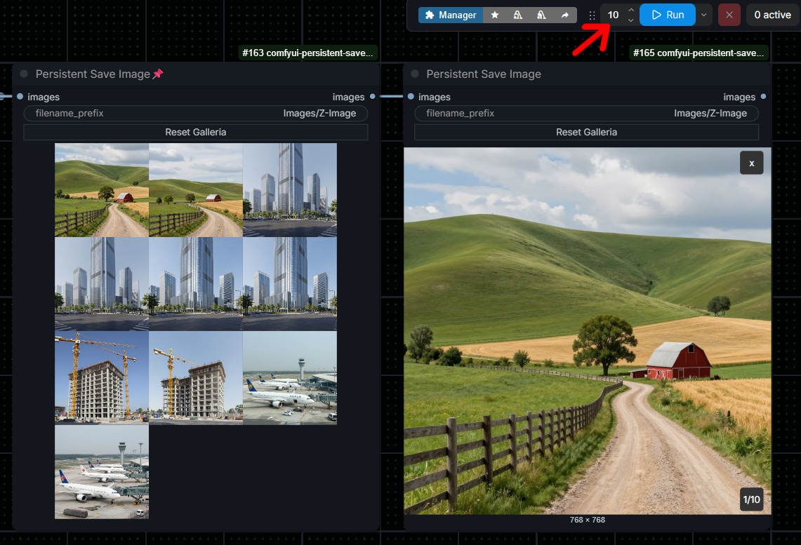

<div align="center">

# ComfyUI Persistent Save Image
**Custom node for Save Image.**


</div>

# ComfyUI Persistent Save Image
**Persistent Save Image** behaves like ComfyUI's native **Save Image** node, but its preview keeps a persistent gallery of the most recently generated images.

It is especially useful for Workflows that use Wildcards, dynamic prompts, and multiple queued executions with `batch_size = 1`. In that setup, every queued prompt can receive a different seed while the node still displays the latest results together in one gallery.

## Features
- Saves PNG files through ComfyUI's native `SaveImage` implementation.
- Supports both:
  - multiple images generated in a single batch with `batch_size > 1`;
  - multiple queued executions with `batch_size = 1`.
- Retains the latest **10** image references per gallery by default.
- Restores the gallery after:
  - switching browser tabs;
  - switching between ComfyUI Workflow tabs;
  - reloading the page;
  - closing and reopening a Workflow;
  - restarting ComfyUI.
- Uses ComfyUI's native image preview grid and image viewer/lightbox.
- Adds a **Reset Galleria** button directly to the node.
- Stores only small JSON references. Image data is not duplicated in browser storage or inside the custom node directory.
- Keeps separate galleries for separate node instances, as long as each node has a unique `gallery_id`.

## Installation

### Git
Open a terminal inside the ComfyUI `custom_nodes` directory and clone the repository:

```bash
cd ComfyUI/custom_nodes
git clone https://github.com/VictorDmAlves/comfyui-persistent-save-image
```

### ZIP
1. Download the repository as a ZIP file.
2. Extract it into `ComfyUI/custom_nodes/`.
3. Make sure the final structure is not nested twice.

Correct:

```text
ComfyUI/
└── custom_nodes/
    └── comfyui-persistent-save-image/
        ├── __init__.py
        ├── config.py
		├── gallery_store.py
		├── persistent_save_image.py
		├── LICENSE
		├── README.md
		├── __pycache__
		├── images/
        └── web/
```

4. Restart ComfyUI completely.
5. Hard-refresh the browser once:

   ```text
   Ctrl+F5
   ```

The node is available at:

```text
image → Persistent Save Image
```

Connect it exactly as you would connect ComfyUI's native **Save Image** node.

No additional Python packages are required.

## Configuration
Open `config.py` to change the maximum number of images retained by each gallery:

```python
MAX_GALLERY_IMAGES = 10
```

Restart ComfyUI after changing this value.

The limit is applied independently to every gallery. For example, with the default value, five independent Persistent Save Image nodes can each retain up to ten image references.

The gallery manifest directory name can also be changed:

```python
GALLERY_STORAGE_DIR_NAME = "persistent_save_image"
```

## How persistence works
Every Persistent Save Image node has a unique `gallery_id`. The identifier is stored redundantly in both the hidden backend widget and the node's serialized properties. This makes the identifier survive normal Workflow saves and Workflow metadata embedded in newly generated PNG files more reliably.

The node does **not** store image bytes inside the Workflow. Instead, the backend stores a small JSON manifest containing references to files already saved in ComfyUI's output directory.

A manifest contains information similar to:

```json
{
  "version": 1,
  "gallery_id": "example-gallery-id",
  "updated_at": 1780000000.0,
  "images": [
    {
      "filename": "ComfyUI_00001_.png",
      "subfolder": "",
      "type": "output"
    }
  ]
}
```

The manifest filename is a SHA-256 hash of the internal `gallery_id`, so manifest filenames will look similar to:

```text
7fc2d8a2e9f4...e91c.json
```

## Gallery storage location
With ComfyUI's default directory structure, gallery manifests are stored in:

```text
ComfyUI/user/persistent_save_image/
```

If ComfyUI is started with a custom user directory, they are stored in:

```text
<custom-user-directory>/persistent_save_image/
```

Changing `GALLERY_STORAGE_DIR_NAME` in `config.py` changes only the final folder name inside the ComfyUI user directory.

## Reset behavior
Clicking **Reset Galleria** deletes the JSON manifest for that gallery and clears the node preview.

It does **not** delete PNG files from ComfyUI's `output` directory.

After a reset:
- Previously saved PNG files remain on disk;
- The node no longer lists those files in its persistent preview;
- Newly generated images begin a new gallery history using the same `gallery_id`.

## Filename prefixes and metadata
The node preserves the normal behavior of ComfyUI's **Save Image** node, including:
- `filename_prefix`;
- Dynamic filename replacements supported by ComfyUI;
- Prompt metadata;
- Workflow metadata;
- Output subfolders.

Metadata availability still depends on the relevant ComfyUI settings and on whether metadata saving has been disabled elsewhere in the Workflow or launch configuration.

## What happens if the output folder is deleted?
Deleting files from ComfyUI's `output` directory does not automatically remove their entries from the gallery manifest.

The JSON manifest will continue to reference those filenames until the gallery is reset or newer images push those references beyond the configured limit.

The visible effect depends on browser state:
- An image already loaded in the browser may remain visible temporarily because of browser cache;
- After the page reloads, the Workflow is reopened, or the browser requests the file again, the missing image will fail to load;
- Restarting ComfyUI does not restore a deleted PNG;
- **Reset Galleria** clears the stale references immediately.

In other words, the file deletion happens immediately, but a cached thumbnail may remain visible until the browser tries to load it again.

## Multiple Workflows and multiple galleries
Yes, multiple Workflows can each keep their own persistent galleries.

A typical setup looks like this:

```text
Workflow A -> gallery_id A -> up to 10 images
Workflow B -> gallery_id B -> up to 10 images
Workflow C -> gallery_id C -> up to 10 images
```

The Workflow stores the `gallery_id`, not the images themselves. Because the manifest is updated independently on the backend, you do not need to save the Workflow again every time new images are generated.

For example:
1. Save a Workflow while its gallery is empty.
2. Generate ten images later.
3. Close the Workflow without saving it again.
4. Reopen the original saved Workflow.
5. The node uses the same saved `gallery_id` and restores the ten images from its manifest.

### Important: duplicated nodes and Workflows
Copying a node may also copy its hidden `gallery_id`.

Duplicating a Workflow, using **Save As**, or copying the node between Workflow tabs may therefore produce two nodes that point to the same gallery:

```text
Original Workflow  --\
                     +--> same gallery_id --> shared gallery
Duplicated Workflow --/
```

This can be useful when a shared gallery is intentional. For a completely independent gallery, delete the copied node and add a new **Persistent Save Image** node from the node menu. A newly created node receives a new identifier.

## Dragging a generated PNG into ComfyUI
When ComfyUI metadata saving is enabled, a newly generated PNG contains the normal prompt and Workflow metadata produced by the native Save Image implementation. The node stores its `gallery_id` redundantly in the serialized Workflow so that dragging the PNG back into ComfyUI can reconnect the restored node to the same gallery manifest.

No minimum number of gallery images is required. A gallery containing one or two images should restore in exactly the same way as a full gallery.

The PNG does **not** contain a historical snapshot of the gallery. The imported node reconnects to the **current** manifest associated with that `gallery_id`.

Example:
1. A PNG is generated when the gallery contains four images.
2. The same gallery later grows to ten images.
3. The older PNG is dragged into ComfyUI.
4. The restored node loads the gallery's current ten images, not the four images that existed when the PNG was created.

The same rule applies in other situations:
- If the gallery was reset and remains empty, the imported Workflow shows an empty gallery;
- If the gallery was reset and then received new images, the imported Workflow shows those current images because the `gallery_id` remains the same;
- If newer images were generated, it shows the latest retained images;
- If output files were deleted, the manifest may still contain references that no longer load;
- The imported Workflow shares the same gallery with the original Workflow because both contain the same `gallery_id`.

## Note About Loading Workflows from PNG Files
When a PNG generated by Persistent Save Image is dragged into ComfyUI, the Workflow and its gallery_id are restored correctly. However, depending on the ComfyUI frontend version, the gallery may initially appear empty.

This happens because importing a Workflow from a PNG does not always trigger the same frontend update event that occurs after a node execution. The gallery is still associated with the correct persistent storage, but its images may not be requested and rendered immediately.

Running the Workflow once, or executing any generation that includes the Persistent Save Image node, will trigger the update and restore the existing gallery images.

No additional images are required, and the gallery data has not been lost. This is only a temporary frontend refresh behavior when loading Workflows from PNG metadata.

## Troubleshooting

### The node does not appear
- Confirm that the folder is located directly under `ComfyUI/custom_nodes/`.
- Restart ComfyUI completely.
- Check the terminal for Python import errors.
- Hard-refresh the browser with `Ctrl+F5`.

### The gallery does not restore
- Confirm that the PNG files still exist in ComfyUI's `output` directory.
- Confirm that the ComfyUI user directory is writable.
- Check whether the manifest exists under `user/persistent_save_image/`.
- Restart ComfyUI and hard-refresh the browser after updating the package.
- For PNG drag-and-drop tests, generate a new PNG with the current build.
- Check the browser developer console and the ComfyUI terminal for errors.

### Two nodes show the same images
The nodes most likely share the same copied `gallery_id`. Remove one of them and create a fresh Persistent Save Image node to generate an independent gallery identifier.

### Deleted images still appear temporarily
The browser may still be displaying cached thumbnails. Reload the page or click **Reset Galleria** to clear the gallery references.

## Technical notes
- Manifests are written atomically to reduce the chance of corruption.
- Gallery access is protected by a backend lock for concurrent queued executions.
- Duplicate image references are removed while preserving the newest occurrence.
- Only the most recent `MAX_GALLERY_IMAGES` references are retained.
- A corrupt or missing manifest does not prevent image generation.
- The frontend periodically refreshes active Persistent Save Image nodes and also refreshes them when the browser regains focus or becomes visible again.

## Contributing
Bug reports and pull requests are welcome. When reporting a problem, please include:
- ComfyUI version or commit
- Persistent Save Image version or commit
- Operating system
- Browser and browser version
- Whether ComfyUI Nodes 2.0 is enabled
- Relevant terminal and browser console error output
- Clear steps to reproduce the issue
- Whether the issue occurs with batch generation, queued prompts, or both
- Whether the gallery was loaded from a saved workflow or from PNG metadata

## License
See [LICENSE](LICENSE).
